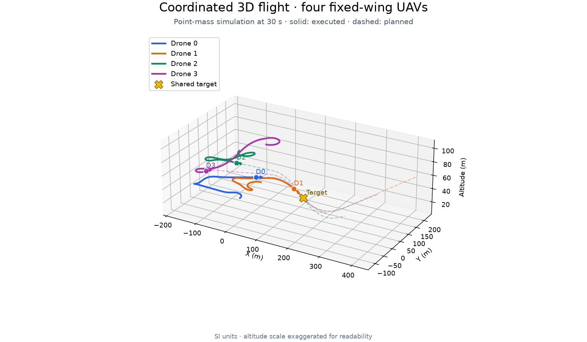
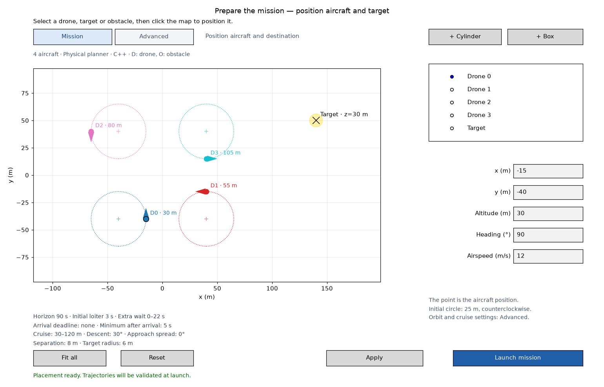

# SwarmTraj

Coordinated 3D trajectory planning for fixed-wing UAV swarms.




*Four-aircraft point-mass simulation. Solid lines show executed paths; dashed
lines show planned paths. Aircraft markers show the state at 30 s.*

## Overview

SwarmTraj plans coordinated fixed-wing missions from one shared initial snapshot.
It generates and validates candidate trajectories offline, selects a compatible
fleet plan, and executes each aircraft's own plan using its own state and clock,
without inter-aircraft telemetry. A Python interface drives the C++20 physical
planner, with a separate adapter for PX4/Gazebo SITL experiments.

## Features

- **3D flight dynamics** — coupled point-mass dynamics with airspeed, bank,
  thrust, drag and flight-envelope checks.
- **Multi-aircraft coordination** — reproducible candidate generation and bounded
  joint selection.
- **Robust separation checks** — full-horizon XYZ checks with tracking-error and
  clock-uncertainty margins.
- **Obstacle avoidance** — static boxes and cylinders, routing proposals and
  integrated clearance validation.
- **Offline execution** — self-contained per-aircraft plans, local tracking and
  reproducible simulation replay.
- **PX4 / Gazebo SITL** — isolated single-aircraft and four-aircraft experiments
  with native autopilots and aerodynamic simulation.



*Prepare the same mission in the Python editor. Mission view shows essential
inputs; Advanced groups detailed settings while preserving configured constraints.*

## Quick start

Requires Linux, Python 3.12+, a C++20 compiler, CMake 3.20+ and Python development
headers. The desktop editor also needs a Matplotlib GUI backend, such as Tk
(`python3-tk` on Ubuntu).

From the repository root, install only the trajectory dependencies and build the
native planner:

```bash
python3 -m venv .venv
.venv/bin/python -m pip install -e '.[trajectory2d]'
./scripts/build_native.sh
```

Launch the four-aircraft demonstration:

```bash
.venv/bin/python examples/trajectory_3d.py
```

The editor opens in **Mission** view. Position the aircraft and target, then
select **Launch mission** to calculate trajectories and open the 3D playback.
New coupled 3D missions use C++ planning by default; Python remains available as
an explicit reference backend. This demo does not require PyBullet, PX4 or Gazebo.

## How it works


Individual trajectories are validated before joint selection. Selection includes
independent full-horizon separation and clearance rechecks before execution.

## Current limitations

- The planning model is an illustrative point-mass model, without calibrated
  aircraft aerodynamics or 6-DoF attitude dynamics.
- Finite candidate catalogs and bounded search can miss feasible solutions.
- Numerical validation depends on the model, tracking and clock assumptions;
  RK4 integration error is not certified.
- Obstacles are static; live fleet replanning and reactive onboard obstacle
  avoidance are not implemented.
- The PX4/Gazebo adapter currently supports one or four aircraft. Its spatial
  missions do not retain the planner's timing or separation claims.

## Documentation

| Topic | Guides |
|---|---|
| Usage and parameters | [3D trajectories](docs/trajectory_3d.md) · [Mission editor](docs/scenario_editor.md) |
| Coordination and physics | [Architecture](docs/architecture.md) · [Flight model](docs/flight_model_3d.md) |
| C++ backend | [Defaults and installation](docs/planner_defaults.md) · [Native kernel and benchmarks](docs/native_kernel.md) |
| Validation and trials | [Scenario campaigns](docs/scaling_campaign.md) · [Flight-envelope validation](docs/flight_envelope_validation.md) |
| PX4 / Gazebo | [Editor and setup](docs/gazebo_editor.md) · [Four-aircraft experiment](docs/gazebo_fleet.md) |
| Reference | [All documentation](docs/README.md) · [Scripts, tests and examples](scripts/README.md) |
