# Planning and execution architecture

The physical C++ planner is shared by the trajectory editor and the optional
PX4/Gazebo preparation path. The point-mass engine and the native aerodynamic
simulator remain separate models. Physical reference generation does not replace
Gazebo aerodynamics or transfer a point-mass safety claim to native execution.

```mermaid
flowchart TD
    Editor["Python editor / CLI: aircraft, target, obstacles and timing"]
    JSON["Shared single/fleet JSON v3: generator + numerical backend; v1/v2 retain historical meanings"]
    Input["Fixed designation snapshot and own physical profiles; input checks and approach sectors"]
    Mode{"Supported production input?"}
    Archive["Inspect archived settings; launch disabled"]
    Migrate["Explicit migration to a new scenario and provenance file"]
    Physical["physical_mission: integrated loiter, levels, transit, approach, passage, pull-out, recovery"]
    Backend{"Physical planner: required C++20 pipeline"}
    Individual{"C++ independent individual validation: forces/envelope, contact, obstacles, full horizon"}
    Catalog["C++ per-aircraft catalogs; serial or Python spawn scheduling"]
    Joint["C++ bounded joint search; full-horizon distance and optional reservations"]
    Expand{"Compatible selection? Budgets available?"}
    Margin["Prefer larger robust slack if requested; preserve all required safety margins"]
    Mission["Immutable original mission; selected own plan per aircraft"]
    Fail["Explicit rejection / exhausted finite catalog / budget diagnostic"]
    ExecBackend{"C++20 own reference, control and motion"}
    Own["Own-state, own-clock point-mass tracker; no true wind or peer inputs"]
    Motion["Separate simulator propagation; synthetic disturbance and own sensor sampling"]
    Eval["Python observer-only execution checks: envelope, tracking, separation and obstacles"]
    Spatial["Derive own spatial PX4 mission and SDF: timing/separation claims are lost"]
    Native["Isolated pinned runtime: one Gazebo world, one or four independent PX4 instances"]
    Gates["Native feasibility/readiness/arm and bounded warm initialization gates"]
    Fly["Native own-aircraft controllers; Gazebo aerodynamic model, sensors and collisions"]
    Observer["Observer-only spatial, contact, obstacle and pair measurements; free camera"]
    End{"Completion policy"}
    Remove["remove-at-target: own observed contact; own removal acknowledged AND absence verified"]
    Land["land: historical native return, landing and disarm gates"]
    Artifacts["Reports, fingerprints, telemetry and measured limitations"]
    Editor --> JSON --> Mode
    Mode -->|retired settings| Archive --> Migrate --> JSON
    Mode -->|physical C++| Input --> Physical --> Backend --> Individual
    Individual -->|accepted| Catalog --> Joint --> Expand
    Individual -->|rejected; attempts remain| Mode
    Individual -->|exhausted| Fail
    Expand -->|compatible| Margin --> Mission
    Expand -->|expand within budgets| Mode
    Expand -->|exhausted| Fail
    Fail -. scenario correction .-> Editor
    Mission --> ExecBackend --> Own --> Motion --> Eval --> Artifacts
    Motion -. own measured state only .-> Own
    Mission --> Spatial --> Native --> Gates --> Fly --> Observer --> End
    End --> Remove --> Artifacts
    End --> Land --> Artifacts
```

The full original horizon always includes initial loiter, transitions, target
passage, pull-out and onward flight. In the explicit simulation-only removal
mode, only the derived native/display prefix and runtime completion change.
The original full-horizon validation is retained. Pair evaluation uses active
overlapping intervals after deletion; missing scene replies cannot establish
successful removal.

Catalog/search hints and geometric routes are ground-side proposals. Controllers
receive their own plan, observed state and clock, without peer telemetry or true
disturbance state. Observer outputs do not become live avoidance commands.
Multiple process counts preserve seeded streams, order and acceptance rules.

The required [C++20 engine](native_kernel.md) runs complete physical construction
loops with resolved own-aircraft parameters and immutable output buffers.
Proposals, NumPy-compatible RNG, independent validation, catalogs and joint
search now also have native implementations. One worker uses the complete
standalone mission API; multiple workers retain Python spawn scheduling.
Independent Python audit validation remains available; it is not a production backend. The
required C++ execution engine performs constrained local control,
own-motion wind estimation, held-command protection and simulator propagation.
Own-clock event scheduling, sensor RNG and independent global checks remain
Python. C++ stores one compact immutable copy of the own plan for reference
state sampling and held-control feedforward averaging; no peer reference enters
a controller. True simulator wind enters only propagation. Numerical planner
identity belongs to the immutable mission; execution identity belongs to the
runtime report. Shared
PX4 editor scenarios v3 persist the selected numerical backend; v1/v2 retain
their Python archive metadata and require explicit migration before production use. Native fleet warm initialization is ordered by ID after the existing
all-aircraft readiness/arming barriers, without claiming timed departure. The existing generated local PDF
predates the mandatory native engine; regenerate it before using it as an
up-to-date architecture illustration.

See [generator migration](generator_migration.md),
[point-mass assumptions](flight_model_3d.md),
[single-aircraft editor](gazebo_editor.md) and [native fleet](gazebo_fleet.md).
This tracked document is the reviewable architecture source.
