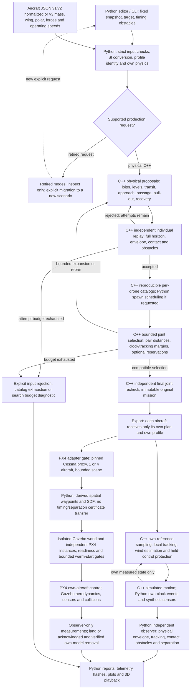

# SwarmTraj architecture

Updated 2026-10-30. C++20 is the only production trajectory-planning and local
point-mass execution engine. Python supplies configuration, the mission editor,
process scheduling, immutable data exchange and independent verification.
PX4/Gazebo is a separate aerodynamic simulation with its own controllers.

## Pipeline



The printable [Graphviz source](architecture.dot) expresses the same major
components. Generate PDF/SVG outputs from the repository root:

```bash
mkdir -p results/architecture-diagram
dot -Tpdf docs/architecture.dot -o results/architecture-diagram/architecture.pdf
dot -Tsvg docs/architecture.dot -o results/architecture-diagram/architecture.svg
```

Graphviz (`dot`) is needed only to render this document, not to run the planner.
Generated illustrations belong in ignored `results/`; tracked Markdown and DOT
sources describe the current implementation. Update both when changing the
pipeline. These are architecture illustrations, not trajectory validation evidence.

## Configuration and aircraft binding

Mission inputs and aircraft physics have separate contracts:

| Input | Contents and application |
|---|---|
| Fixed designation snapshot | Initial position, heading, bank implied by loiter, altitude and total airspeed; never refreshed during planning |
| Mission/environment configuration | Target, initial/cruise altitudes, horizon, arrival deadline, obstacles, margins and search budgets |
| Aircraft profile v1/v2 | Complete normalized flight parameters; v2 additionally declares an enclosing sphere |
| Aircraft profile v3 | Mass, wing area, constant density, parabolic polar, thrust/braking forces and enclosing sphere; Python derives normalized physics once |
| Optional v3 operating speeds | Loiter, climb, cruise, descent and dive total airspeeds; fresh CLI missions default to declared cruise speed |
| Shared PX4 scenario v1/v2/v3 | A separate schema family; historical generator/backend selections retain their meaning and are not silently upgraded |

`--flight-regime` selects one declared mission-wide speed. Explicit `--airspeed`
or `--drone-speed` overrides the default cruise request; combining those with an
explicit regime is rejected. Phase-dependent automatic speed switching is not
implemented. Loading a profile into the editor preserves the existing snapshot;
it does not silently substitute nominal speeds or enlarge loiter circles.

Profiles are immutable, strictly validated and hashed with their original
physical inputs. Unknown fields and ambiguous sources of physics are refused.
A common profile or an exact per-ID assignment binds each aircraft's own limits
through generation, validation and execution. Whole-fleet profile maps remain
ground-side; own payloads contain no peer plans or telemetry.

The v3 conversion uses the same seven-state coordinated point-mass equations:
`[x, y, z, total_airspeed, heading, flight_path_angle, bank]`. It does not add
6-DoF inertia, control surfaces, calibrated propulsion curves or changing density.
See [aircraft profiles](aircraft_profiles.md),
[heterogeneous aircraft](heterogeneous_aircraft.md) and
[flight equations](flight_model_3d.md).

## Native planning and validation

One worker calls the complete standalone C++ mission API. Explicit multiple
workers keep deterministic, spawn-based Python scheduling around native catalogs;
worker errors propagate and transferred plan arrays remain read-only. There is
no Python production fallback and no thread-pool replacement.

C++ owns deterministic approach-sector assignment, NumPy-compatible PCG64 streams,
physical proposals, resumable catalogs, rejection feedback, optional obstacle
routing and departure-window hints. These hints propose candidates; they never
establish safety. An independently replayed candidate must pass before entering
joint selection. Bounded search preserves candidate order, budgets and required
margins, optionally preferring greater separation slack. Final full-horizon
checks are independent of the search caches.

Initial loiter, altitude transitions, passage, pull-out and onward flight all
remain inside the validated horizon. Initial altitude, cruise levels and target
altitude are distinct. Reaching a target does not stop an aircraft. For example,
a 2 m target with a 30-degree descending passage can be rejected because the
post-passage recovery would cross the ground; the planner does not remove that
recovery or lower the altitude floor to obtain a result.

`no_candidate`, `catalog_exhausted` and `search_budget_exhausted` describe a
finite algorithm's outcome, not continuous-space infeasibility. Python retains
separately written audit equations, analytical fixtures and individual replay;
these do not constitute an executable Python planning backend.

## Execution boundaries

| Component | Implementation and information boundary |
|---|---|
| Own reference sampling | C++ caches a compact immutable copy of one aircraft's state/control history |
| Local controller | C++ uses own measured state and clock, own plan, own physical limits and own-motion wind estimate |
| Protection and propagation | C++ verifies held controls and integrates motion; true synthetic wind enters simulator propagation only |
| Event and sensor scheduling | Python schedules each own clock's actuator switches and reproducible measurement noise |
| Global observer | Python may inspect all aircraft for evaluation and visualization; it never sends control corrections |
| Independent audits | Python physics and geometry checks remain separate from native construction and selection |

Failed protection fallback invalidates execution acceptance. Evaluation preserves
both sides of asynchronous actuator switches and checks tracking, clock and
full-horizon separation assumptions. Wall-clock measurements stay outside the
reproducible mission hash; faster computation is not a real-time guarantee.

## PX4/Gazebo boundary

The current optional adapter supports one or four aircraft with a pinned Cessna
fixture, independent PX4 instances/ports/log directories and an isolated runtime.
It refuses alternate planning-airframe bindings: loading a custom v3 profile
into the point-mass simulator does not replace Gazebo's airframe or PX4 tuning.
The shared edited-scenario gate currently requires 10–16 m/s airspeed, initial
and target altitudes of 20–100 m, loiter radii of 80–500 m and a level target
passage. Those are adapter bounds, not general Gazebo limits. The planner's
proxy also retains its own altitude floor. A 2 m target therefore belongs only
to the separately configured point-mass path today.

Spatial waypoints and display/termination prefixes are derived from the
immutable original plan. PX4 rounding, takeoff/join and native control do not
preserve the point-mass timing or separation claims. All original model-horizon
checks remain unchanged. Native readiness/feasibility/arm barriers and bounded
warm-initialization gates precede flight; the bootstrap is observer-only afterwards.

`land` retains return/landing/disarm checks. In the explicit simulation-only
`remove-at-target` mode, each own model is removed on observed contact only with
acknowledgement **and** verified scene absence. Missing scene replies cannot
establish successful removal. Pair observation uses active overlapping intervals
after removal. Camera services remain GUI-only and cannot control aircraft.

A separate [compact control-model qualification workflow](compact_control_model.md)
uses an experimental 4999 airframe, profile-bound C++ forces/moments and own
measured joint inputs. It has passed isolated trim, startup and unarmed
actuator checks, but runway flight trials remain unsuccessful. It is not an
alternate production selector or a general replacement for the pinned Cessna
adapter. Its raw native circuit is not a SwarmTraj executable plan and carries
no point-mass timing, separation or obstacle validation.

The point-mass engine can accept higher declared speed ranges; it has not been
qualified for 200 km/h flight. Such use needs representative aircraft parameters,
larger maneuvers and numerical/trajectory checks. Raising a JSON speed limit does
not establish adequate propulsion, tracking performance or native-model fidelity.

## Main implementation locations

| Responsibility | Files |
|---|---|
| Configuration, profiles and production policy | `src/swarm_sim/trajectory2d/{planning,aircraft_profiles,production}.py` |
| Python/native adapters | `src/swarm_sim/trajectory2d/{native_planning,native_backend,parallel,catalog}.py` |
| Native dynamics, proposals and catalogs | `native/src/{flight,proposals,catalog,random,approach}.cpp` |
| Native search and independent checks | `native/src/{search,reservations,validation,joint_validation,mission}.cpp` |
| Native own reference and controller | `native/src/execution.cpp` |
| Independent replay and observation | `src/swarm_sim/trajectory2d/{flight3d,coupled_planning,tracking,execution,execution_safety,contact}.py` |
| Editor and visualization | `src/swarm_sim/trajectory2d/{scenario_editor,visualization,visualization3d}.py` |
| PX4 preparation and runtime | `src/swarm_sim/{px4_scenario,px4_fleet,px4_reference,px4_gazebo,px4_scene,px4_termination}.py` |
| Camera firewall | `src/swarm_sim/px4_camera.py` |

The separate PyBullet quadrotor and fixed-wing ring examples remain outside
this trajectory pipeline. Numerical acceptance is conditional on the model,
tracking tubes and clock bounds; RK4 has no certified integration-error bound.
No real-aircraft certification or formal collision-freedom claim is made.

See [production policy](planner_defaults.md), [native engine](native_kernel.md),
[mission timing](mission_timing.md), [single-aircraft adapter](gazebo_editor.md)
and [fleet adapter](gazebo_fleet.md).
